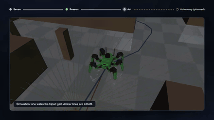

# Hi, I'm Oscar

Data Scientist and Engineer with a Ph.D. in Physics, focused on cloud data platforms, telemetry pipelines, analytics engineering, and production data systems.

## [Personal Website ↗](https://www.oscarjavierhernandez.com/)

6+ years in industry, a Ph.D. in computational nuclear physics from UBC, and 290+ citations.

My website has more about me: my [CV](https://www.oscarjavierhernandez.com/resume/), [academic research and publications](https://www.oscarjavierhernandez.com/research/), [projects](https://www.oscarjavierhernandez.com/projects/), and [writing](https://www.oscarjavierhernandez.com/blog/) on mathematics, physics, and software engineering.

## Technical Focus

- Python, SQL, PySpark
- GCP, AWS, Azure, Databricks
- Airflow, BigQuery, Terraform
- Data modeling, ETL/ELT, analytics engineering
- A/B testing, product analytics, telemetry systems

## Current Interests

- Applied statistics and probability
- Data modeling, dbt, and modern analytics engineering
- Streaming data systems
- Distributed systems
- Optimal pricing experimentation and lifecycle analytics

## [Agentic Systems Lab ↗](https://agentic-systems-lab.alpharelay.dev/)

**[Visit the live site → agentic-systems-lab.alpharelay.dev](https://agentic-systems-lab.alpharelay.dev/)**

Data platforms, agent systems, and language model applications, run on my own hardware: local models on a GMKtec EVO-X2, simulated customer data on a Raspberry Pi cluster, and apps on a self-hosted Kubernetes cluster.

<table>
  <tr>
    <td width="50%" align="center">
       
      <b><a href="https://agentic-systems-lab.alpharelay.dev/#customer-intelligence-platform">Experimentation Factory</a></b> 
      Simulated customers send real events through Kafka and Flink into a lakehouse.
    </td>
    <td width="50%" align="center">
       
      <b><a href="https://agentic-systems-lab.alpharelay.dev/#sophy">Sophy</a></b> 
      A local language model reads a robot's sensors through tools and proposes actions behind safety gates.
    </td>
  </tr>
  <tr>
    <td width="50%" align="center">
       
      <b><a href="https://agentic-systems-lab.alpharelay.dev/#apollo-lyceum">Apollo Lyceum</a></b> 
      Interview practice built from textbook problems, with exercises that run in the browser.
    </td>
    <td width="50%" align="center">
       
      <b><a href="https://agentic-systems-lab.alpharelay.dev/#circuitwild">Circuitwild</a></b> 
      A multiplayer Python and SQL game where each faction is run by an autonomous AI.
    </td>
  </tr>
</table>

### Deployed apps

Two applications running on the lab's Kubernetes cluster.

<table>
  <tr>
    <td width="50%" align="center">
       
      <b><a href="https://knitter.alpharelay.dev">Knitter</a></b> 
      A workspace for knitters and crocheters: pattern library, row counters, and a yarn stash.
    </td>
    <td width="50%" align="center">
       
      <b><a href="https://rank.alpharelay.dev">RANK</a></b> 
      A recommender that learns your taste from pairwise choices between titles.
    </td>
  </tr>
</table>
