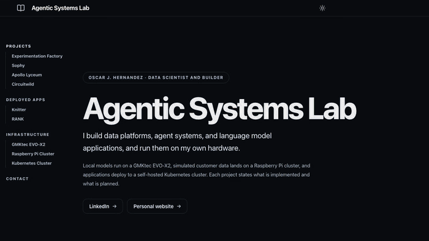
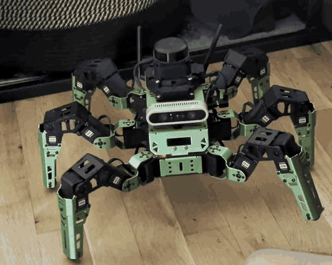
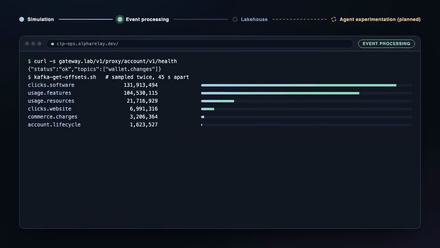
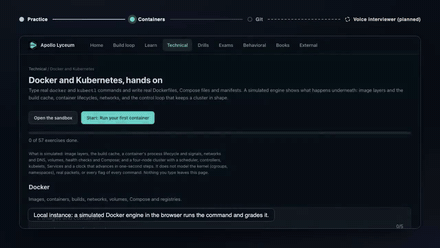
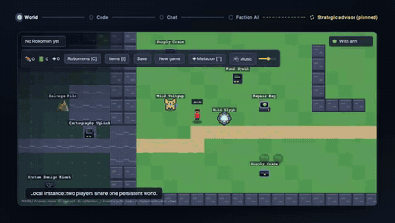
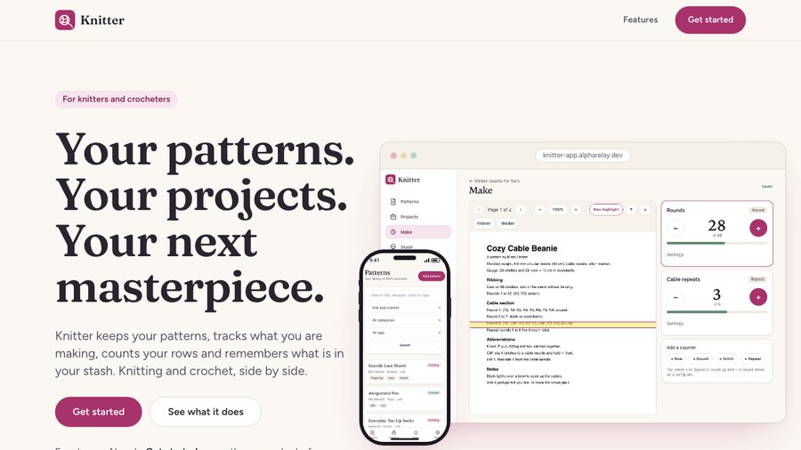

<h1 align="center">Hi, I'm Oscar</h1>

  Data Scientist and Engineer with a Ph.D. in Physics, focused on cloud data platforms, telemetry pipelines, analytics engineering, and production data systems.

  
  
  

## [Personal Website ↗](https://www.oscarjavierhernandez.com/)

**[Visit the live site → oscarjavierhernandez.com](https://www.oscarjavierhernandez.com/)**

6+ years in industry, a Ph.D. in computational nuclear physics from UBC, and 290+ citations.

My website has more about me: my [CV](https://www.oscarjavierhernandez.com/resume/), [academic research and publications](https://www.oscarjavierhernandez.com/research/), [projects](https://www.oscarjavierhernandez.com/projects/), and [writing](https://www.oscarjavierhernandez.com/blog/) on mathematics, physics, and software engineering.

<table>
  <tr>
    <td width="50%" valign="top">
      <h3>Technical Focus</h3>
      <ul>
        <li>Python, SQL, PySpark</li>
        <li>GCP, AWS, Azure, Databricks</li>
        <li>Airflow, BigQuery, Terraform</li>
        <li>Data modeling, ETL/ELT, analytics engineering</li>
        <li>A/B testing, product analytics, telemetry systems</li>
      </ul>
    </td>
    <td width="50%" valign="top">
      <h3>Current Interests</h3>
      <ul>
        <li>Applied statistics and probability</li>
        <li>Data modeling, dbt, and modern analytics engineering</li>
        <li>Streaming data systems</li>
        <li>Distributed systems</li>
        <li>Optimal pricing experimentation and lifecycle analytics</li>
      </ul>
    </td>
  </tr>
</table>

## [Agentic Systems Lab ↗](https://agentic-systems-lab.alpharelay.dev/)

**[Visit the live site → agentic-systems-lab.alpharelay.dev](https://agentic-systems-lab.alpharelay.dev/)**

Data platforms, agent systems, and language model applications, run on my own hardware: local models on a GMKtec EVO-X2, simulated customer data on a Raspberry Pi cluster, and apps on a self-hosted Kubernetes cluster.

### [Sophy ↗](https://agentic-systems-lab.alpharelay.dev/#sophy)

<table>
  <tr>
    <td width="52%" align="center" valign="top">
      
    </td>
    <td width="48%" valign="top">
      A local language model reads a robot's sensors through tools and proposes actions. Nothing moves until an agent check, the operator, and the robot's own safety gates all pass.
        
      <b>On the robot:</b>
      <ul>
        <li>LiDAR</li>
        <li>RGB and depth camera</li>
        <li>18 servos</li>
        <li>NVIDIA Jetson Nano running ROS</li>
      </ul>
    </td>
  </tr>
</table>

### More projects

<table>
  <tr>
    <td width="33%" align="center" valign="top">
       
      <b><a href="https://agentic-systems-lab.alpharelay.dev/#customer-intelligence-platform">Experimentation Factory</a></b> 
      Simulated customers send real events through Kafka and Flink into a lakehouse.
    </td>
    <td width="33%" align="center" valign="top">
       
      <b><a href="https://agentic-systems-lab.alpharelay.dev/#apollo-lyceum">Apollo Lyceum</a></b> 
      Interview practice built from textbook problems, with exercises that run in the browser.
    </td>
    <td width="33%" align="center" valign="top">
       
      <b><a href="https://agentic-systems-lab.alpharelay.dev/#circuitwild">Circuitwild</a></b> 
      A multiplayer Python and SQL game where each faction is run by an autonomous AI.
    </td>
  </tr>
</table>

### Deployed apps

Two applications running on the lab's Kubernetes cluster.

<table>
  <tr>
    <td width="50%" align="center" valign="top">
       
      <b><a href="https://knitter.alpharelay.dev">Knitter</a></b> 
      A workspace for knitters and crocheters: pattern library, row counters, and a yarn stash.
    </td>
    <td width="50%" align="center" valign="top">
       
      <b><a href="https://rank.alpharelay.dev">RANK</a></b> 
      A recommender that learns your taste from pairwise choices between titles.
    </td>
  </tr>
</table>
